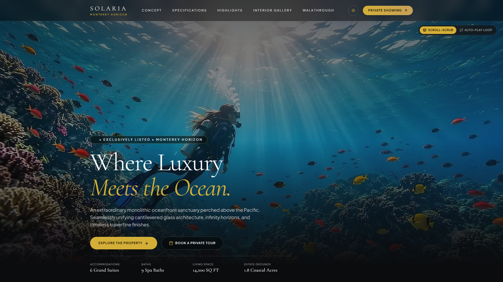
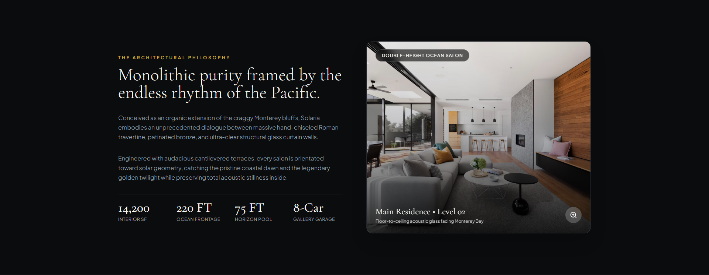
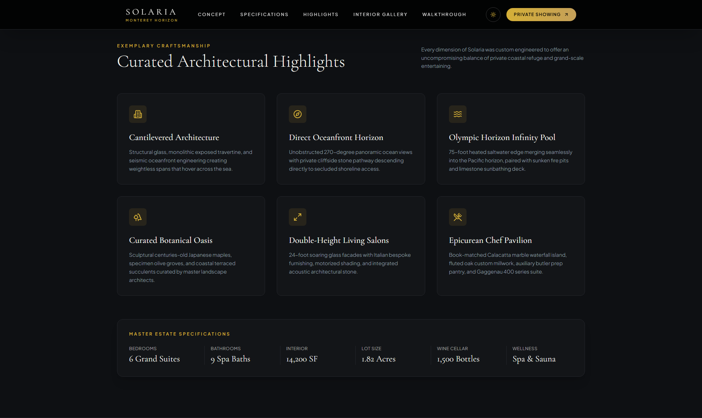
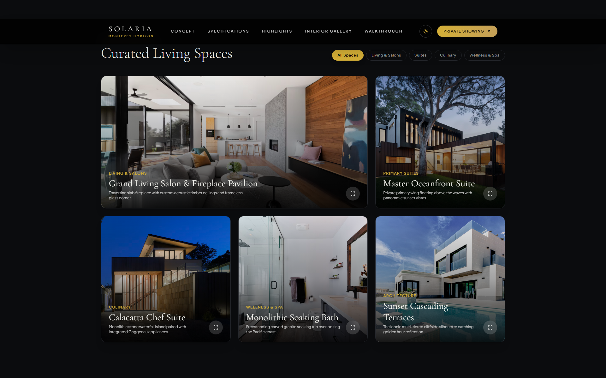
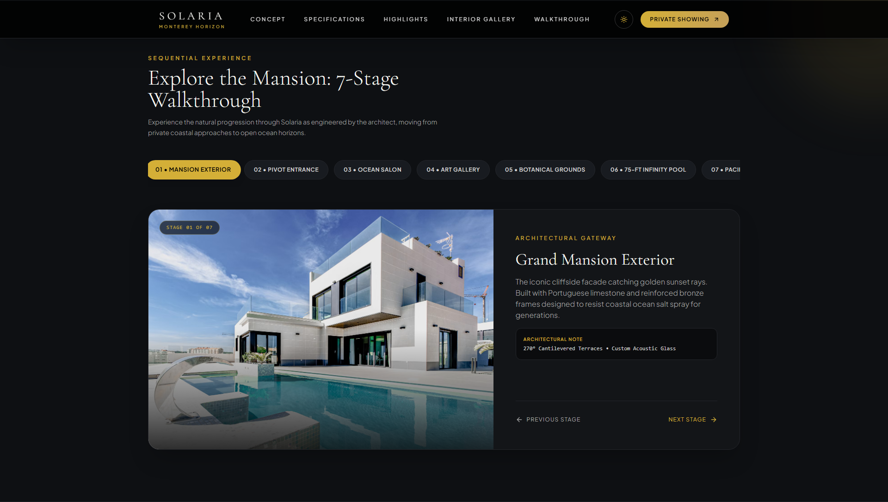
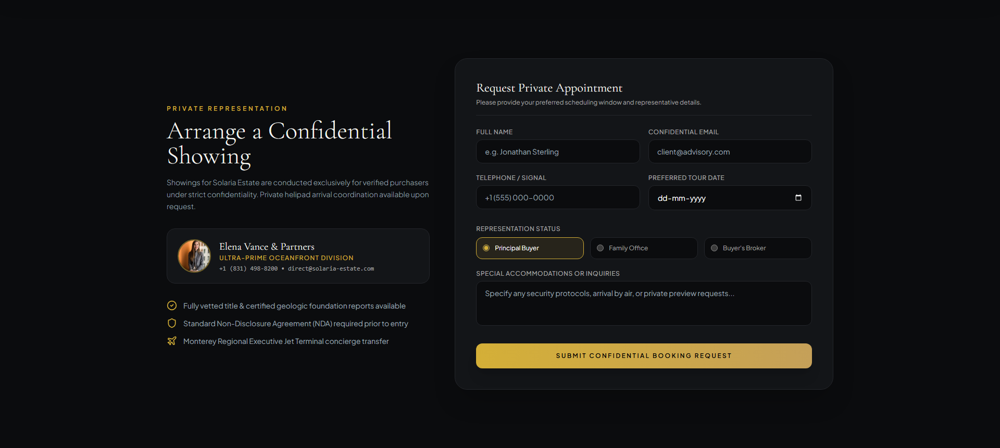
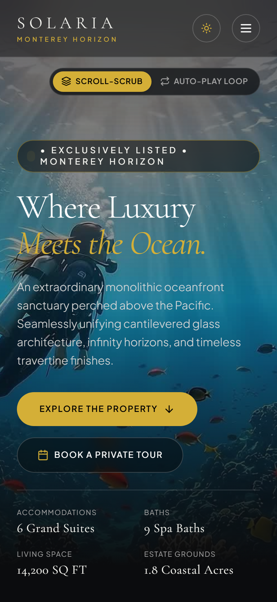

<div align="center">

# 🏛️ Solaria Oceanfront Estate — Monterey Horizon

### Ultra-Luxury Architectural Real Estate Web Experience

[](https://reactjs.org/)
[](https://www.typescriptlang.org/)
[](https://vitejs.dev/)
[](https://tailwindcss.com/)
[](https://lucide.dev/)
[](LICENSE)

<p align="center">
  <a href="#-project-overview">Overview</a> •
  <a href="#-visual-showcase">Showcase</a> •
  <a href="#-core-features">Features</a> •
  <a href="#-tech-stack--architecture">Tech Stack</a> •
  <a href="#-project-structure">Structure</a> •
  <a href="#-installation--local-development">Installation</a> •
  <a href="#-environment-configuration">Configuration</a> •
  <a href="#-repository-information">Repository</a>
</p>

---

</div>

## 📖 Project Overview

**Solaria Oceanfront Estate — Monterey Horizon** is a high-performance, ultra-luxury digital showcase engineered for ultra-prime architectural real estate. Modeled as a monolithic coastal sanctuary perched above the Pacific bluffs in Monterey, California, the application blends modern web standards with high-end editorial aesthetics.

The centerpiece of the platform is an **Apple-inspired hardware-accelerated 168-frame `<canvas>` image sequence animation engine**, featuring dual-mode **scroll-driven scrubbing** with linear interpolation (`lerp`) and **30 FPS auto-play looping**. The rest of the platform provides rich scrollytelling sections, filterable bento galleries, an interactive 7-stage architectural walkthrough, and a confidential acquisition scheduling portal.

### 🌟 Highlights
- **168-Frame High-Resolution Sequence Engine:** Static asset streaming through Vite public directory with zero runtime bundling overhead.
- **Retina Crisp `<canvas>` Rendering:** Dynamic `window.devicePixelRatio` compensation, sub-pixel cover scaling, and asynchronous background frame pre-decoding (`Image.decode()`) for zero frame drops or white flashes.
- **Editorial Dark Aesthetic:** Handcrafted color palette featuring `#0B0C0E` deep blacks, `#131518` elevated surface cards, subtle `#24262B` borders, and Champagne Gold (`#D4AF37` / `#C5A059`) accents.
- **Sophisticated Typography:** Paired Google Fonts display serif **Cormorant Garamond** with clean, geometric sans-serif **Plus Jakarta Sans**.

---

## 📸 Visual Showcase

### 1. Hero Showcase with 168-Frame Interactive `<canvas>` Sequence
Full-bleed cinematic canvas animation with scroll-scrub physics, live dual-mode playback toggle, and key architectural spec bar.


---

### 2. The Architectural Philosophy
Two-column editorial split highlighting monolithic travertine, patinated bronze, 4-stat metric bar, and interactive Level 02 Ocean Salon card with high-resolution lightbox.


---

### 3. Curated Architectural Highlights & Master Estate Specifications
3x2 architectural feature grid paired with a full-width horizontal master estate specifications strip.


---

### 4. Curated Living Spaces (Filterable Bento Gallery + Lightbox)
Asymmetric 5-card bento grid with category filter pills (`All Spaces`, `Living & Salons`, `Suites`, `Culinary`, `Wellness & Spa`) and high-resolution lightbox modal.


---

### 5. Explore the Mansion: 7-Stage Walkthrough
Interactive architectural stepper moving through 7 progressive estate vantage points with badges, architectural note callouts, and smooth cross-fading.


---

### 6. Confidential Showing Request & Brokerage Profile
Principal Broker Elena Vance representation profile, verified trust badges (title/geologic reports, NDA requirement, executive jet transfer), and confidential inquiry form.


---

### 7. Responsive Mobile Layout
Pixel-perfect mobile adaptation supporting gesture touch scrubbing, responsive navigation drawer, and stacked luxury typography.
<div align="center">
  
</div>

---

## ✨ Core Features & Technical Deep Dives

### 1. Hardware-Accelerated Hero Canvas Sequence
- **Location:** `src/components/HeroSequence.tsx`
- **Frame Manifest:** `src/config/heroFrames.ts` auto-discovers and maps 168 sequential frames (`ezgif-frame-001.jpg` to `ezgif-frame-168.jpg`).
- **Smooth Inertia:** Employs linear interpolation (`currentFrame += (targetFrame - currentFrame) * 0.16`) inside `requestAnimationFrame` for silky, liquid frame transitions.
- **Dual Playback Modes:**
  - **Scroll-Scrub:** Tracks scroll progress through a `300vh` sticky container.
  - **Auto-Play Loop:** Automatically advances frames at an exact 30 FPS interval with play/pause toggling.
- **Async Decoding:** Executes `Image.prototype.decode()` in background promises to prevent main-thread layout pauses during frame rendering.

### 2. Glassmorphism Sticky Navigation
- **Location:** `src/components/Navbar.tsx`
- **Dynamic Backdrop:** Adapts background opacity and border intensity upon scroll (`scrollY > 40px`).
- **Interactive Controls:** Includes anchor navigation links, theme toggle switch, mobile hamburger drawer, and gold `Private Showing ↗` CTA.

### 3. Filterable Bento Gallery & Lightbox Modal
- **Location:** `src/components/GallerySection.tsx` & `src/components/LightboxModal.tsx`
- **Dynamic Category Filtering:** Instant state filtering without layout shift across primary architectural spaces.
- **Fullscreen Modal:** Displays high-resolution imagery with metadata, backdrop click dismiss, and `Escape` key listeners.

### 4. 7-Stage Architectural Walkthrough Stepper
- **Location:** `src/components/WalkthroughSection.tsx`
- **Progressive Navigation:** 7 discrete stages (`Mansion Exterior`, `Pivot Entrance`, `Ocean Salon`, `Art Gallery`, `Botanical Grounds`, `75-FT Infinity Pool`, `Pacific Horizon Sunset`).
- **Visual Feedback:** Animated stage badge, architectural detail callouts, and keyboard/button progression.

### 5. Confidential Booking Portal & Representation
- **Location:** `src/components/ContactSection.tsx`
- **Buyer Persona Options:** Interactive radio pills (`Principal Buyer`, `Family Office`, `Buyer's Broker`).
- **State Feedback:** Client-side validation with responsive submission confirmation banners.

---

## 🛠️ Tech Stack & Architecture

| Layer | Technology | Purpose |
| :--- | :--- | :--- |
| **Frontend Library** | [React 18.3.1](https://reactjs.org/) | Declarative component hierarchy and reactive state management |
| **Language** | [TypeScript 5.4.5](https://www.typescriptlang.org/) | Strict static type safety across components, props, and configurations |
| **Bundler & Tooling** | [Vite 5.3.1](https://vitejs.dev/) | Lightning-fast ESM dev server and optimized Rollup production builds |
| **CSS Framework** | [Tailwind CSS 3.4.4](https://tailwindcss.com/) | Utility-first responsive design, custom palettes, and animations |
| **Post-Processing** | [PostCSS 8.4](https://postcss.org/) & [Autoprefixer](https://github.com/postcss/autoprefixer) | Vendor-prefix automation and modern CSS transformations |
| **Iconography** | [Lucide React 0.460](https://lucide.dev/) | Lightweight, customizable SVG icons matching luxury aesthetic |
| **Automation** | [Puppeteer Core 24.4](https://pptr.dev/) | Headless Chrome automation for high-resolution visual documentation |

---

## 📂 Project Structure

```text
RealEstate/
├── dist/                           # Compiled production build output
│   ├── assets/                     # Optimized JS & CSS bundles
│   ├── images/                     # 168 static sequence frames
│   └── index.html                  # Minified entry point
├── public/                         # Public static assets served by Vite
│   ├── images/                     # ezgif-frame-001.jpg .. ezgif-frame-168.jpg
│   └── VideoProject-ezgif-split/   # Alternative static frame route
├── screenshots/                    # Captured authentic UI screenshots
│   ├── 01-hero-showcase.png
│   ├── 02-architectural-philosophy.png
│   ├── 03-curated-highlights.png
│   ├── 04-living-spaces-bento.png
│   ├── 05-interactive-walkthrough.png
│   ├── 06-confidential-showing.png
│   └── 07-mobile-responsive.png
├── scripts/                        # Documentation and capture automation
│   └── capture-screenshots.js      # Headless Chrome screenshot capture script
├── src/                            # Application source code
│   ├── components/                 # Modular React components
│   │   ├── ContactSection.tsx      # Broker info & confidential booking form
│   │   ├── Footer.tsx              # Minimalist luxury footer
│   │   ├── GallerySection.tsx      # Filterable living spaces bento grid
│   │   ├── HeroSequence.tsx        # Canvas image sequence scrub & autoplay
│   │   ├── HighlightsSection.tsx   # 3x2 highlights & master specifications
│   │   ├── LightboxModal.tsx       # Fullscreen high-res image modal
│   │   ├── Navbar.tsx              # Glassmorphic header & navigation
│   │   ├── PhilosophySection.tsx   # 2-column editorial philosophy & stats
│   │   └── WalkthroughSection.tsx  # 7-stage architectural stepper
│   ├── config/                     # Configuration and manifests
│   │   └── heroFrames.ts           # 168-frame URL manifest and helpers
│   ├── types/                      # TypeScript interfaces and type definitions
│   │   └── index.ts                # Gallery, Walkthrough, and Lightbox types
│   ├── App.tsx                     # Main application layout orchestrator
│   ├── index.css                   # Tailwind directives & luxury styling
│   └── main.tsx                    # React DOM root entry point
├── .env.example                    # Template environment variables
├── .gitignore                      # Git exclusion rules
├── index.html                      # HTML5 template with Google Fonts
├── package.json                    # Project dependencies and npm scripts
├── postcss.config.js               # PostCSS plugins configuration
├── tailwind.config.js              # Custom theme extensions and colors
├── tsconfig.json                   # TypeScript compiler configuration
├── tsconfig.node.json              # TypeScript configuration for Vite/Node
└── vite.config.ts                  # Vite build tool configuration
```

---

## 🚀 Installation & Local Development

### Prerequisites
- [Node.js](https://nodejs.org/) (Version `>= 18.0.0` recommended)
- [npm](https://www.npmjs.com/) (Version `>= 9.0.0`) or `pnpm` / `yarn`
- Google Chrome (optional, required only for regenerating screenshots via Puppeteer)

### Step-by-Step Setup

1. **Clone the Repository:**
   ```bash
   git clone https://github.com/sanketuparate/new.git
   cd new
   ```

2. **Install Dependencies:**
   ```bash
   npm install
   ```

3. **Start the Development Server:**
   ```bash
   npm run dev
   ```
   Open [http://localhost:3000](http://localhost:3000) (or the port indicated in your terminal) in your browser.

4. **Build for Production:**
   ```bash
   npm run build
   ```
   Compiles TypeScript and bundles assets into the `dist/` directory with zero errors.

5. **Preview Production Build Locally:**
   ```bash
   npm run preview
   ```

6. **Regenerate Screenshots:**
   ```bash
   npm run screenshots
   ```
   Launches headless Chrome, serves the build, and updates `./screenshots/`.

---

## ⚙️ Environment Configuration

Copy the template file to configure your local environment:

```bash
cp .env.example .env.local
```

### Supported Variables

| Variable | Description | Default | Confidentiality |
| :--- | :--- | :--- | :--- |
| `VITE_SITE_URL` | Base production or staging deployment URL | `http://localhost:3000` | Public |
| `VITE_ANALYTICS_ID` | Optional web analytics measurement ID | `""` | Public |
| `VITE_BROKER_INQUIRY_ENDPOINT` | Optional webhook endpoint for confidential bookings | `""` | Private / Internal |

> **Note:** Never commit production credentials, webhook secrets, or API keys to version control. All `.env*.local` files are ignored by default in `.gitignore`.

---

## 🔗 Repository Information

- **Repository:** [https://github.com/sanketuparate/new](https://github.com/sanketuparate/new)
- **Primary Branch:** `main`
- **Owner / Author:** [sanketuparate](https://github.com/sanketuparate)
- **Confidentiality:** Confidential Architectural Offering

---

## 📄 License & Disclaimer

This project is open-source under the [MIT License](LICENSE). Architectural renders, photography, and conceptual designs are for portfolio and demonstration purposes.
